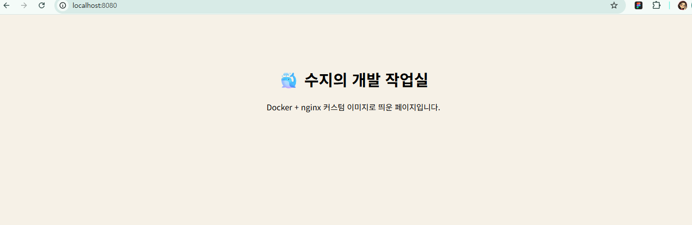
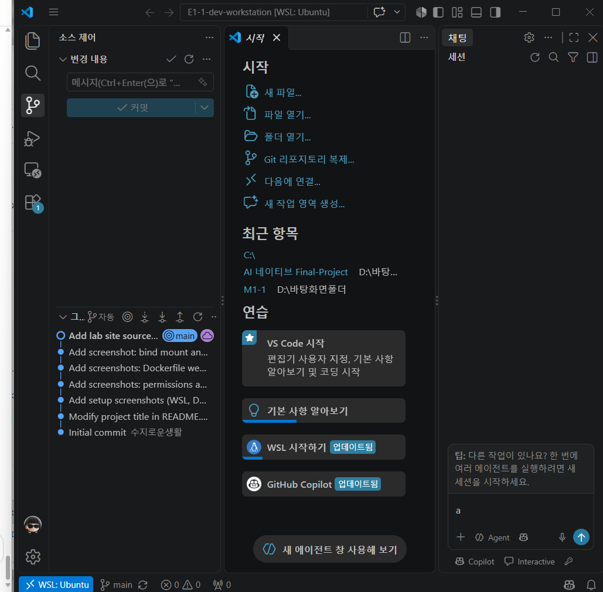

# E1-1. 내 컴퓨터에 개발자용 '작업실' 꾸미기

코디세이 입학연수 - 개발 워크스테이션 구축

## 1. 프로젝트 개요

터미널(Linux CLI), Docker, Git/GitHub를 직접 세팅하고, **실행 결과(로그·접속·데이터 유지)** 로 동작을 검증한 기록입니다.

- 터미널로 작업 디렉토리를 만들고 파일·권한을 다룬다.
- Docker를 설치·점검하고 컨테이너를 실행/관리한다.
- `nginx:alpine` 기반 커스텀 이미지(연구소 페이지)를 Dockerfile로 직접 만들고 포트 매핑으로 접속한다.
- 바인드 마운트로 "변경 반영", Docker 볼륨으로 "데이터 영속성"을 검증한다.
- Git 설정 후 GitHub·VS Code와 연동한다.

## 2. 실행 환경

| 항목 | 내용 |
|---|---|
| OS | Windows 11 + WSL2 (Ubuntu) |
| Shell / 터미널 | bash / Windows Terminal |
| Docker | Docker Desktop (WSL2 backend), Docker 29.9.3 |
| Git | 2.53.0 (Ubuntu) |
| 에디터 | VS Code + WSL 확장 |

> 수행은 두 대의 PC에서 했습니다. 1~29번 스크린샷은 첫 번째 PC(Ubuntu 사용자 `suji`), 30번과 `web/` 재작성·재검증은 두 번째 PC(노트북)입니다. 홈 경로(`/home/<사용자>`)만 다르고 절차는 같습니다.

## 3. 수행 체크리스트

- [x] 터미널 기본 조작 및 폴더 구성 → [4-1](#4-1-터미널-기본-조작)
- [x] 권한 변경 실습 (파일 1개, 디렉토리 1개) → [4-2](#4-2-권한-실습)
- [x] Docker 설치 / 점검 → [4-3](#4-3-docker-설치-및-점검)
- [x] Docker 기본 운영 명령 (images, ps, logs, stats) → [4-4](#4-4-컨테이너-실행-및-운영)
- [x] hello-world 실행, ubuntu 컨테이너 진입, attach/exec 차이 → [4-4](#4-4-컨테이너-실행-및-운영)
- [x] Dockerfile 커스텀 이미지 빌드 / 실행 → [4-5](#4-5-dockerfile-커스텀-이미지)
- [x] 포트 매핑 접속 (8080, 8081) → [4-6](#4-6-포트-매핑-접속)
- [x] 바인드 마운트 반영 → [4-7](#4-7-바인드-마운트-반영)
- [x] 볼륨 영속성 → [4-8](#4-8-docker-볼륨-영속성)
- [x] Git 설정 + VS Code GitHub 연동 → [4-9](#4-9-git-설정-및-github--vs-code-연동)

모든 증거 스크린샷 목록: [docs/screenshots/README.md](docs/screenshots/README.md)

## 4. 수행 로그와 검증

### 4-1. 터미널 기본 조작

현재 위치 확인, 숨김 파일 포함 목록, 생성, 이동

```bash
$ pwd
/home/suji/E1-1-dev-workstation
$ ls -la
total 16
drwxr-xr-x 3 suji suji 4096 Nov 13 16:52 .
drwxr-x--- 6 suji suji 4096 Nov 13 16:52 ..
drwxr-xr-x 7 suji suji 4096 Nov 13 16:52 .git
-rw-r--r-- 1 suji suji   69 Nov 13 16:52 README.md
$ mkdir practice
$ cd practice
$ pwd
/home/suji/E1-1-dev-workstation/practice
```

빈 파일 생성, 내용 확인, 복사, 이름 변경, 삭제

```bash
$ touch empty.txt
$ echo "Hello Codyssey" > hello.txt
$ cat hello.txt
Hello Codyssey
$ cp hello.txt hello_copy.txt
$ mv hello_copy.txt renamed.txt
$ ls -la
-rw-r--r-- 1 suji suji    0 Nov 13 17:00 empty.txt
-rw-r--r-- 1 suji suji   15 Nov 13 17:00 hello.txt
-rw-r--r-- 1 suji suji   15 Nov 13 17:00 renamed.txt
$ rm renamed.txt
$ ls -la
-rw-r--r-- 1 suji suji    0 Nov 13 17:00 empty.txt
-rw-r--r-- 1 suji suji   15 Nov 13 17:00 hello.txt
```

증거: [16](docs/screenshots/16_terminal-pwd-ls-mkdir-cd.png), [17](docs/screenshots/17_terminal-file-ops.png)

**절대 경로 vs 상대 경로**: `/home/suji/E1-1-dev-workstation/practice`처럼 `/`(루트)부터 쓰는 것이 절대 경로이고, 현재 위치 기준으로 `cd practice`, `cd ..`처럼 쓰는 것이 상대 경로입니다.

### 4-2. 권한 실습

```bash
# 파일: 644 → 755
$ ls -l hello.txt
-rw-r--r-- 1 suji suji 15 Nov 13 17:00 hello.txt
$ chmod 755 hello.txt
$ ls -l hello.txt
-rwxr-xr-x 1 suji suji 15 Nov 13 17:00 hello.txt

# 디렉토리: 755 → 700
$ mkdir secret
$ ls -ld secret
drwxr-xr-x 2 suji suji 4096 Nov 13 17:11 secret
$ chmod 700 secret
$ ls -ld secret
drwx------ 2 suji suji 4096 Nov 13 17:11 secret
```

증거: [18](docs/screenshots/18_chmod-file-dir-before-after.png)

**권한 숫자 읽는 법**: r=4, w=2, x=1을 더한 숫자를 소유자/그룹/기타 순서로 씁니다.
`755` = rwx(7) / r-x(5) / r-x(5), `644` = rw-(6) / r--(4) / r--(4), `700` = 소유자만 rwx.
디렉토리의 x는 "안으로 들어갈 수 있는 권한"입니다.

### 4-3. Docker 설치 및 점검

Docker Desktop을 WSL2 백엔드로 설치하고, Settings → WSL integration에서 Ubuntu를 연결했습니다.

```bash
$ docker --version
Docker version 29.9.3, build 5457199
$ docker info
...
Kernel Version: 6.18.58.1-microsoft-standard-WSL2
Operating System: Docker Desktop
OSType: linux
Architecture: x86_64
...
```

증거: [10](docs/screenshots/10_docker-install-config-wsl2.png), [11](docs/screenshots/11_docker-wsl-integration.png), [13](docs/screenshots/13_docker-info-success.png)

### 4-4. 컨테이너 실행 및 운영

hello-world

```bash
$ docker run hello-world
Hello from Docker!
This message shows that your installation appears to be working correctly.
$ docker ps -a
CONTAINER ID   IMAGE         COMMAND    CREATED         STATUS                     NAMES
1699da801045   hello-world   "/hello"   2 seconds ago   Exited (0) 2 seconds ago   stoic_visvesvaraya
$ docker images
IMAGE                ID             DISK USAGE   CONTENT SIZE
hello-world:latest   cf1b20a0c89a   25.9kB       9.49kB
```

ubuntu 컨테이너 진입

```bash
$ docker run -it ubuntu bash
root@675d94ab2bc0:/# ls
bin  boot  dev  etc  home  lib  lib64  media  mnt  opt  proc  root  run  sbin  srv  sys  tmp  usr  var
root@675d94ab2bc0:/# echo "Hello from container"
Hello from container
root@675d94ab2bc0:/# exit
```

exec vs attach

```bash
$ docker run -dit --name my-ubuntu ubuntu bash
$ docker exec -it my-ubuntu bash     # 새 bash 프로세스로 들어감
root@63074b35d6a0:/# exit
$ docker ps
63074b35d6a0   ubuntu   "bash"   Up About a minute   my-ubuntu      # 계속 실행 중
$ docker attach my-ubuntu            # 메인 프로세스(PID 1)에 붙음
root@63074b35d6a0:/# exit
$ docker ps -a
63074b35d6a0   ubuntu   "bash"   Exited (127) 6 seconds ago   my-ubuntu   # 컨테이너 종료
```

| | exec | attach |
|---|---|---|
| 들어가는 대상 | 새로 띄운 프로세스 | 컨테이너의 메인 프로세스 |
| `exit` 후 | 컨테이너 **유지** (Up) | 메인 프로세스가 끝나 컨테이너 **종료** (Exited) |

logs / start / stats / stop

```bash
$ docker logs my-ubuntu
$ docker start my-ubuntu
my-ubuntu
$ docker stats --no-stream
CONTAINER ID   NAME        CPU %   MEM USAGE / LIMIT     MEM %   NET I/O          PIDS
63074b35d6a0   my-ubuntu   0.00%   2.496MiB / 62.68GiB   0.00%   1.17kB / 126B    1
$ docker stop my-ubuntu
my-ubuntu
```

증거: [19](docs/screenshots/19_docker-hello-world.png), [20](docs/screenshots/20_docker-images-ubuntu-container.png), [22](docs/screenshots/22_docker-exec-vs-attach.png), [23](docs/screenshots/23_docker-logs-start-stats-stop.png)

### 4-5. Dockerfile 커스텀 이미지

방식 **(A) 웹 서버 베이스 이미지 + 정적 콘텐츠 교체**를 선택했습니다. 소스: [web/](web/)

```dockerfile
FROM nginx:alpine
LABEL maintainer="soupie21c"
COPY index.html /usr/share/nginx/html/index.html
EXPOSE 80
```

| 커스텀 포인트 | 목적 |
|---|---|
| `FROM nginx:alpine` | 가벼운 공식 웹 서버 이미지를 기반으로 사용 |
| `LABEL maintainer` | 이미지 작성자 메타데이터 기록 |
| `COPY index.html` | 기본 nginx 페이지를 내 페이지("수지의 개발 작업실")로 교체 |
| `EXPOSE 80` | 컨테이너가 80번 포트를 쓴다는 것을 문서화 |

```bash
$ cd web
$ docker build -t my-web:1.0 .
 => [2/2] COPY index.html /usr/share/nginx/html/index.html
 => naming to docker.io/library/my-web:1.0
$ docker run -d --name my-web -p 8080:80 my-web:1.0
$ docker ps
CONTAINER ID   IMAGE        COMMAND                  STATUS          PORTS                                     NAMES
1e7b93d5e923   my-web:1.0   "/docker-entrypoint.…"   Up 22 seconds   0.0.0.0:8080->80/tcp, [::]:8080->80/tcp   my-web
```

증거: [25](docs/screenshots/25_dockerfile-nano.png), [26](docs/screenshots/26_docker-build-run-ps.png)

### 4-6. 포트 매핑 접속

```bash
$ curl localhost:8080
<!DOCTYPE html>
<html lang="ko">
<head><meta charset="UTF-8"><title>Suji Workstation</title></head>
<body style="font-family:sans-serif;text-align:center;padding-top:80px;background:#f6f1e7">
  <h1>🐳 수지의 개발 작업실</h1>
  <p>Docker + nginx 커스텀 이미지로 띄운 페이지입니다.</p>
</body>
</html>
```

브라우저 `localhost:8080` 접속 화면 (주소창 포함)



증거: [27](docs/screenshots/27_curl-localhost-8080.png), [28](docs/screenshots/28_browser-localhost-8080.png)

**포트 매핑이 필요한 이유**: 컨테이너는 격리된 네트워크 안에 있어서, 컨테이너의 80번 포트는 호스트에서 바로 보이지 않습니다. `-p 8080:80`은 "호스트 8080으로 온 요청을 컨테이너 80으로 넘긴다"는 뜻이고, 같은 이미지라도 `-p 8081:80`처럼 호스트 포트만 바꿔 여러 개를 띄울 수 있습니다.

### 4-7. 바인드 마운트 반영

호스트 폴더를 nginx의 웹 루트에 그대로 연결하고, 호스트에서 파일을 고친 뒤 컨테이너 재시작 없이 반영되는지 확인했습니다.

```bash
$ docker run -d --name my-web-bind -p 8081:80 -v "$(pwd)":/usr/share/nginx/html nginx:alpine

$ curl -s localhost:8081 | tail -3          # 변경 전
  <p>Docker + nginx 커스텀 이미지로 띄운 페이지입니다.</p>
</body>
</html>

$ echo "<p>바인드 마운트로 수정!</p>" >> index.html   # 호스트에서 수정

$ curl -s localhost:8081 | tail -3          # 변경 후
</body>
</html>
<p>바인드 마운트로 수정!</p>
```

증거: [29](docs/screenshots/29_bind-mount-after-and-volume-persistence.png)

### 4-8. Docker 볼륨 영속성

```bash
$ docker volume create my-data
my-data
$ docker run -d --name vol-test -v my-data:/data ubuntu sleep infinity
$ docker exec vol-test sh -c 'echo "volume data" > /data/hello.txt'
$ docker exec vol-test cat /data/hello.txt
volume data

$ docker rm -f vol-test                      # 컨테이너 삭제
vol-test

$ docker run --rm -v my-data:/data ubuntu cat /data/hello.txt   # 새 컨테이너에서 확인
volume data
```

컨테이너를 지워도 볼륨에 쓴 데이터는 남습니다.

증거: [29](docs/screenshots/29_bind-mount-after-and-volume-persistence.png)

**볼륨이란**: 컨테이너 안에 쓴 데이터는 컨테이너를 지우면 함께 사라집니다. 볼륨은 Docker가 관리하는 별도 저장 공간이라 컨테이너 수명과 상관없이 유지되고, 여러 컨테이너가 같은 볼륨을 붙여 쓸 수 있습니다. 바인드 마운트는 "내가 고른 호스트 폴더"를 연결하고, 볼륨은 "Docker가 관리하는 공간"을 연결한다는 점이 다릅니다.

### 4-9. Git 설정 및 GitHub / VS Code 연동

```bash
$ git config --global user.name "soupie21c"
$ git config --global user.email "soupie21c@users.noreply.github.com"
$ git config --global init.defaultBranch main
$ git config --list
user.name=soupie21c
user.email=soupie21c@users.noreply.github.com
init.defaultbranch=main
$ git clone https://github.com/soupie21c/E1-1-dev-workstation.git
```

이메일은 개인 주소 노출을 막기 위해 GitHub noreply 주소를 사용했습니다.

VS Code에서 WSL(Ubuntu)로 저장소를 열고 GitHub 계정으로 로그인했습니다. 소스 제어 그래프에서 `main` 브랜치와 원격(origin) 커밋이 연동된 것을 확인했습니다.



증거: [14](docs/screenshots/14_git-config-list.png), [15](docs/screenshots/15_git-clone.png), [30](docs/screenshots/30_vscode-github-login.png)

**Git vs GitHub**: Git은 내 컴퓨터에서 버전(커밋)을 관리하는 도구이고, GitHub는 그 저장소를 원격에 올려 공유·협업하는 플랫폼입니다. `commit`까지는 로컬, `push`/`pull`부터 GitHub와 주고받습니다.

## 5. 트러블슈팅

### 1) `wsl --install`이 0.0%에서 멈춤

- **문제**: `wsl --install` 실행 후 진행률이 0.0%에서 더 나가지 않았다. ([01](docs/screenshots/01_wsl-install-stuck-0percent.png))
- **원인 가설**: 기본 다운로드 경로(Microsoft Store)에서 받아오지 못하고 있다.
- **확인**: `--web-download` 옵션으로 Store를 거치지 않고 받으니 WSL 설치는 진행됐지만, Ubuntu 설치가 다시 0%에서 멈췄다. ([02](docs/screenshots/02_wsl-web-download-ubuntu-0percent.png)) 메시지를 보니 VirtualMachinePlatform 기능이 활성화되고 재부팅이 필요한 상태였다. ([03](docs/screenshots/03_vmp-enabled-reboot-required.png))
- **해결**: 첫 재부팅 후에도 같은 메시지가 반복되어([04](docs/screenshots/04_reboot-not-applied.png)) 다시 완전히 재부팅했고, 이후 Ubuntu 설치가 끝났다. ([05](docs/screenshots/05_ubuntu-installed-create-user.png))

### 2) Ubuntu 사용자명 `admin` 생성 실패

- **문제**: Ubuntu 첫 실행 시 사용자명을 `admin`으로 입력하니 생성에 실패했다. ([06](docs/screenshots/06_ubuntu-user-admin-exists-error.png))
- **원인 가설**: Ubuntu에 이미 `admin`이라는 시스템 그룹이 있어서 같은 이름으로 사용자 그룹을 만들 수 없다.
- **해결**: 다른 이름(`suji`)으로 생성하니 정상적으로 만들어졌다. ([07](docs/screenshots/07_ubuntu-user-created.png))

### 3) Docker 설치 파일 "다른 프로그램에서 사용 중"

- **문제**: Docker Desktop 설치 파일을 실행하니 파일이 사용 중이라는 오류가 났다. ([09](docs/screenshots/09_docker-installer-file-in-use.png))
- **원인 가설**: 다운로드가 끝나지 않았거나, 이전에 실행한 설치 프로그램이나 백신 검사가 파일을 잡고 있다.
- **해결**: 실행 중인 설치 프로그램을 닫고 다시 실행해서 설치를 진행했다. 설치 옵션은 Per-user, WSL 2를 선택했다. ([10](docs/screenshots/10_docker-install-config-wsl2.png))

### 4) `docker info`: permission denied

- **문제**: Ubuntu에서 `docker info`를 실행하면 클라이언트 정보만 나오고 Server 부분에서 오류가 났다.
  ```
  permission denied while trying to connect to the docker API at unix:///var/run/docker.sock
  ```
  ([12](docs/screenshots/12_docker-info-permission-denied.png))
- **원인 가설**: WSL integration을 켠 직후라, 열려 있던 터미널 세션에 docker 소켓 접근 권한(그룹 설정)이 아직 반영되지 않았다.
- **해결**: 터미널을 닫고 다시 여니 `docker info`가 정상 출력됐다. ([13](docs/screenshots/13_docker-info-success.png))

### 5) 컨테이너 안에서 `docker: command not found`

- **문제**: `docker exec -it my-ubuntu bash`로 들어간 뒤 `docker ps`, `docker attach`를 치니 `command not found`가 났다. ([21](docs/screenshots/21_docker-cmd-inside-container-error.png))
- **원인**: 프롬프트가 `root@63074b35d6a0:/#`로, 이미 **컨테이너 안**이었다. ubuntu 이미지에는 docker CLI가 없다.
- **해결**: `exit`로 호스트(`suji@...$`)로 나온 뒤 docker 명령을 실행했다. 이후 프롬프트로 "지금 어디에 있는지"를 먼저 확인하는 습관을 들였다.

### 6) nano 저장 시 파일 이름이 `cat index.html`로 저장됨

- **문제**: `nano index.html`로 작성 후 `ls`를 하니 `'cat index.html'`이라는 파일이 생겨 있었다. ([24](docs/screenshots/24_nano-filename-mistake.png))
- **원인**: 저장할 때 나오는 "File Name to Write:" 입력칸에 `cat index.html`을 명령어처럼 입력해서 그 문자열이 그대로 파일 이름이 됐다.
- **해결**: `mv 'cat index.html' index.html`처럼 따옴표로 감싸 이름을 바꿨다. 이후 저장할 때는 파일 이름만 확인하고 Enter를 눌렀다.

### 7) (두 번째 PC) Docker는 실행 중인데 WSL에서 `docker: command not found`

- **문제**: 노트북에 Docker Desktop을 설치·실행했는데, Ubuntu에서 `docker --version`을 실행하면 `command not found`가 났다.
- **원인 가설**: Docker 엔진은 Windows 쪽에서만 돌고 있고, Ubuntu 배포판과 연결(WSL integration)되지 않았다.
- **확인**: Ubuntu를 재시작(`wsl --terminate Ubuntu`)해도 같았다. Docker 설정 파일에 `IntegratedWslDistros` 항목이 없었다.
- **해결**: Settings → Resources → WSL integration에서 Ubuntu를 켜고 **Apply**를 누르니 해결됐다. 설정 화면에서 스위치만 켜고 Apply를 누르지 않으면 저장되지 않는다.
  ```
  $ docker --version
  Docker version 29.9.3, build 5457199
  ```

## 6. 재현 방법

```bash
git clone https://github.com/soupie21c/E1-1-dev-workstation.git
cd E1-1-dev-workstation/web
docker build -t my-web:1.0 .
docker run -d --name my-web -p 8080:80 my-web:1.0
curl localhost:8080
```

- Windows에서는 Docker Desktop의 WSL integration에서 사용하는 배포판을 켜야 WSL 터미널에서 `docker`를 쓸 수 있습니다.
- 8080 포트가 사용 중이면 `-p 8090:80`처럼 호스트 포트만 바꿔 실행하세요.

## 7. 보안 및 개인정보

- 로그·스크린샷에 토큰, 비밀번호, 개인키, 인증 코드가 포함되지 않도록 확인했습니다.
- GitHub 인증은 Git Credential Manager(브라우저 로그인)를 사용해 토큰을 파일이나 문서에 남기지 않았습니다.
- Git 커밋 이메일은 GitHub noreply 주소(`soupie21c@users.noreply.github.com`)로 설정했습니다.
